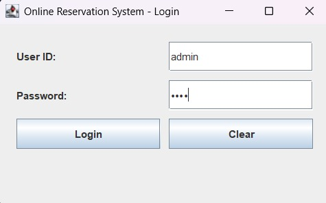
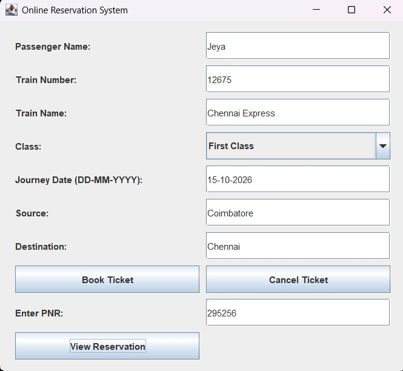
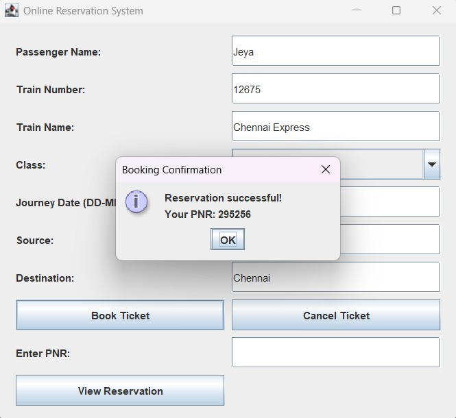
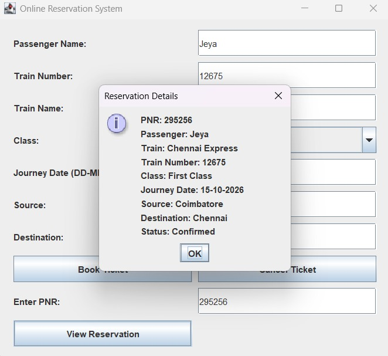
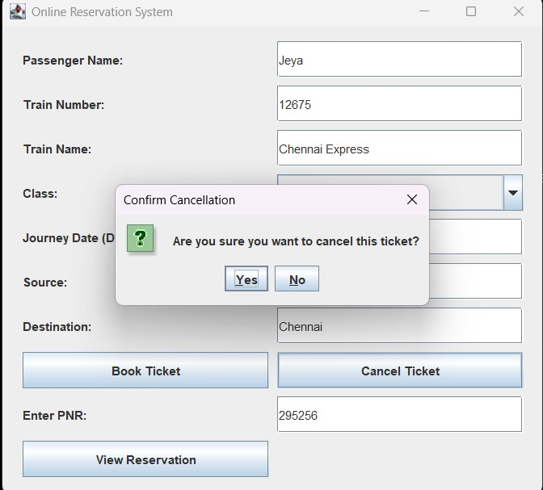
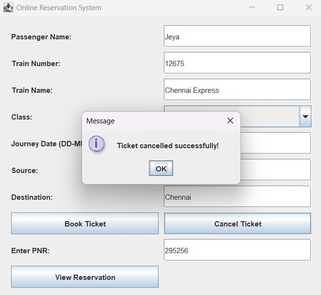
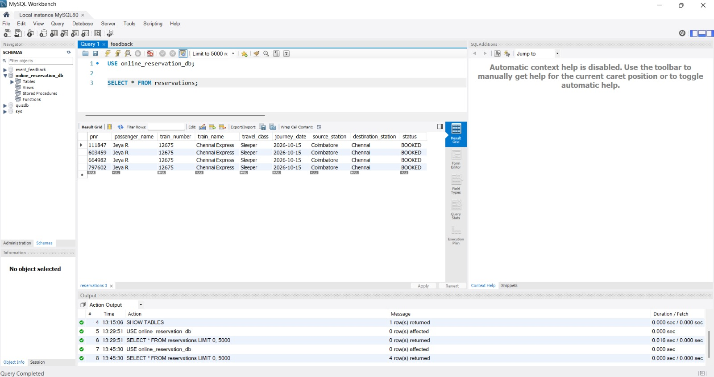

# 🚆 Online Reservation System

## 📌 Project Overview

The Online Reservation System is a Java Swing desktop application that allows users to book train reservations, view reservation details using a PNR number, and cancel tickets. The application uses JDBC to connect to a MySQL database and permanently store reservation details.

## ✨ Features

- **Login System:** Demo user authentication.
- **Ticket Booking:** Enter passenger and train details.
- **PNR Generation:** Automatically generates a six-digit PNR.
- **View Reservation:** Retrieve reservation details using PNR.
- **Ticket Cancellation:** Cancel a booking using its PNR.
- **Database Integration:** Store and retrieve reservations using MySQL.
- **Status Management:** Track bookings with `BOOKED` and `CANCELLED` statuses.
- **GUI:** User-friendly interface developed using Java Swing.

## 🛠️ Technologies Used

- Java
- Java Swing
- JDBC (Java Database Connectivity)
- MySQL
- MySQL Connector/J
- Visual Studio Code
- MySQL Workbench

## 🗂️ Project Structure

```text
Java-Task-3-OnlineReservationSystem/
├── lib/
│   └── mysql-connector-j-26.7.0.jar
├── screenshots/
│   ├── login.png
│   ├── reservation-form.png
│   ├── booking-confirmation.png
│   ├── reservation-details.png
│   ├── cancel-confirmation.png
│   ├── booking-cancellation.png
│   └── database-records.png
├── DBConnection.java
├── LoginFrame.java
├── Main.java
├── Reservation.java
├── ReservationFrame.java
├── ReservationManager.java
└── README.md
```

## ⚙️ Prerequisites

- Java JDK installed
- MySQL Server installed and running
- MySQL Workbench
- MySQL Connector/J JDBC driver

## 🗄️ Database Setup

Create the database:

```sql
CREATE DATABASE online_reservation_db;
USE online_reservation_db;
```

Create the reservations table:

```sql
CREATE TABLE reservations (
    pnr VARCHAR(10) PRIMARY KEY,
    passenger_name VARCHAR(100) NOT NULL,
    train_number VARCHAR(20) NOT NULL,
    train_name VARCHAR(100) NOT NULL,
    travel_class VARCHAR(30) NOT NULL,
    journey_date DATE NOT NULL,
    source_station VARCHAR(100) NOT NULL,
    destination_station VARCHAR(100) NOT NULL,
    status VARCHAR(20) DEFAULT 'BOOKED'
);
```

## 🚀 How to Run

### 1. Configure the database password

Set your MySQL password as a PowerShell environment variable:

```powershell
$env:DB_PASSWORD = Read-Host "Enter MySQL password"
```

Enter your MySQL root password when prompted. Do not commit passwords to GitHub.

### 2. Compile the Java files

Run the following command from the project directory:

```powershell
javac -cp ".;lib\mysql-connector-j-26.7.0.jar" *.java
```

### 3. Run the application

```powershell
java -cp ".;lib\mysql-connector-j-26.7.0.jar" Main
```

## 🔐 Demo Login

- **User ID:** `admin`
- **Password:** `1234`

These credentials are for the demonstration application only.

## 📸 Screenshots

### Login Screen


### Reservation Form


### Booking Confirmation


### Reservation Details


### Cancellation Confirmation


### Cancellation Success


### MySQL Database Records


## 🧪 Testing

The application has been tested for:

- Login authentication
- Ticket booking and PNR generation
- Viewing reservation details
- Ticket cancellation
- JDBC connection to MySQL
- Storing and retrieving reservation records
- Updating reservation status in the database

## ⚠️ Disclaimer

This is an educational project developed for learning Java, JDBC, and MySQL. It is a demonstration application and does not book actual railway tickets or connect to a real railway reservation service.